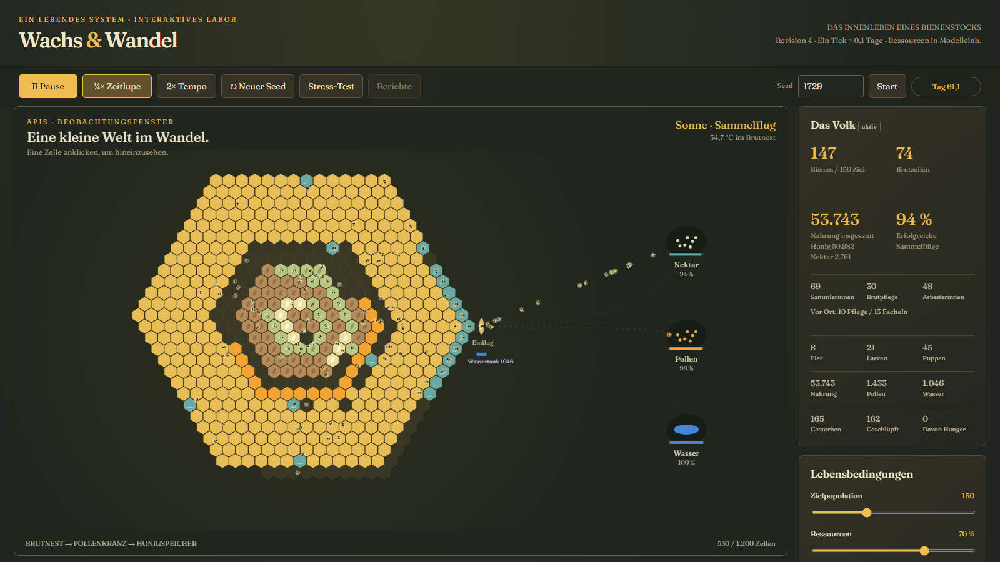

# Honig & Wachs im Wandel

Interaktive Bienenstock-Simulation als **eine einzige HTML-Datei**. HTML, CSS und JavaScript sind inline,
es gibt keine Frameworks und keine externen Dateien. Die Oberfläche der Simulation trägt den Titel „Wachs & Wandel“.

## Starten

**Im Browser:** <https://jkegithub.github.io/Honig-Wachs-im-Wandel/>

**Offline:** [`index.html`](index.html) herunterladen (auf GitHub „Download raw file“) und per Doppelklick
im Browser öffnen. Es wird kein Server gebraucht.
Die Simulation startet in ¼×-Zeitlupe. Ein Klick auf „¼× Zeitlupe“ schaltet auf Normaltempo
(1 Sim-Tag pro Sekunde), „2× Tempo“ verdoppelt.

## Was diese Variante auszeichnet

- **Reproduzierbar:** Jeder Lauf hat einen Seed, und gleicher Seed bedeutet gleicher Verlauf.
- **Prüfbar:** `window.BeeLab` erlaubt Vorspulen ohne Rendering, Fehlerinjektion und eine vollständige Abnahme über 20 Seeds
  (Button „Abnahme · 20 Seeds prüfen“).
- **Selbstprüfung mit 9 Invarianten**, darunter Ressourcenbilanz mit Toleranz 0, Honigherkunft,
  Stillstandsfreiheit, Lagerreservierungen und Populationserhaltung.
- **Arbeit vor Ort:** Ammen besuchen Larven, Arbeiterinnen fächeln und bauen an der Zelle, und die Temperatur
  wirkt auf die Entwicklung der Brut.
- **Kollapsbericht** mit Ursachenkette, 30-Tage-Vorgeschichte und Slider-Stellungen.

## Aufgabe und Abnahme

| Datei | Inhalt |
|---|---|
| [`PROMPT.md`](PROMPT.md) | Die Aufgabenbeschreibung: Prompt #24 „Bienenstock-Simulation (Version 2)“, unverändert, mit sha256 |
| [`ANALYSE.md`](ANALYSE.md) | Unabhängige Messung und Abnahme dieser Lösung, mit Verlauf über drei Revisionen und offenen Punkten |
| [`STATUS.md`](STATUS.md) | Aktueller Stand |

## Verwandtes Projekt

[`bienenstock-simulation`](https://github.com/Jkegithub/bienenstock-simulation) ist die erste Variante,
gebaut nach Prompt #1. Aus ihren Befunden entstand Prompt #24, auf dem diese zweite Variante beruht.

## Lizenz

Code: [MIT](LICENSE). Schrift: SIL Open Font License 1.1 (siehe unten).

## Schrift

**Fraunces**, © 2018 The Fraunces Project Authors, SIL Open Font License 1.1. Eingebettet als
WOFF2-Teilmenge; der Lizenztext steht am Ende von `index.html`.
